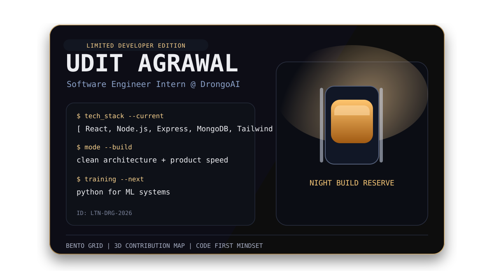

 

<table>
  <tr>
    <td width="50%" valign="top">
      
        
      <code>Role</code> Software Engineer Intern @ DrongoAI 
      <code>Stack</code> MERN + Tailwind CSS 
      <code>Focus</code> Clean architecture, product-speed shipping 
      <code>Learning</code> Python for ML systems
    </td>
    <td width="50%" valign="top">
      
        
      
      
       
      
       
      
    </td>
  </tr>
</table>

 

<table>
  <tr>
    <td width="33%" valign="top">
      
        
      
    </td>
    <td width="33%" valign="top">
      
        
      
    </td>
    <td width="33%" valign="top">
      
        
      
    </td>
  </tr>
</table>

 

  
    
  

 

  
  

