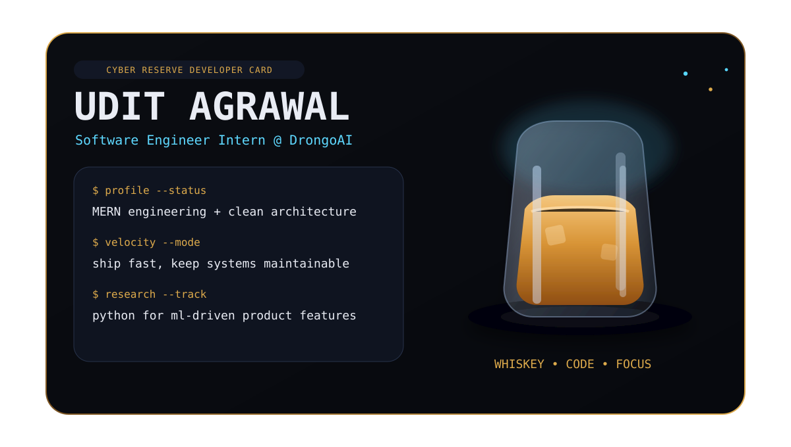
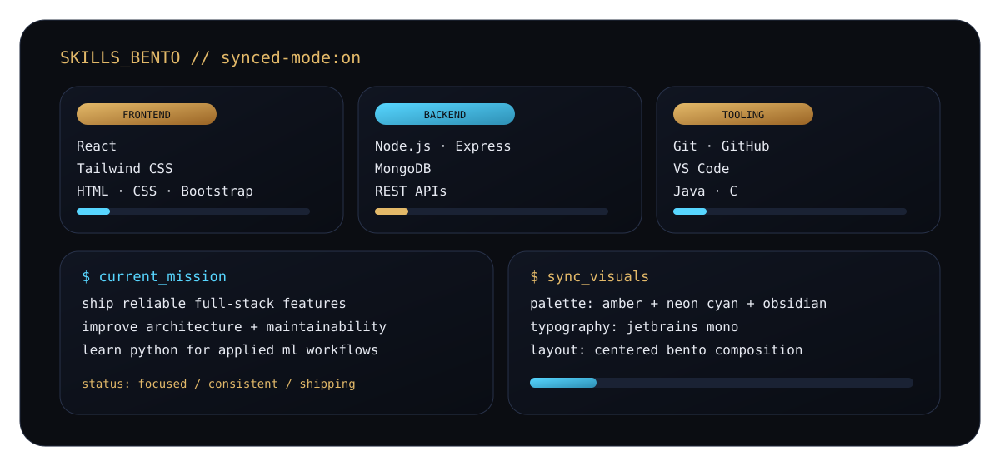

  

 

  <pre>
guest@LighTnos:~$ whoami
udit-agrawal

role       : Software Engineer Intern @ DrongoAI
stack      : React · Node.js · Express · MongoDB · Tailwind CSS
focus      : scalable product engineering
learning   : Python + Machine Learning systems
  </pre>

 

  

 

  
    
  
    
  

 

  
  

 

  
  

