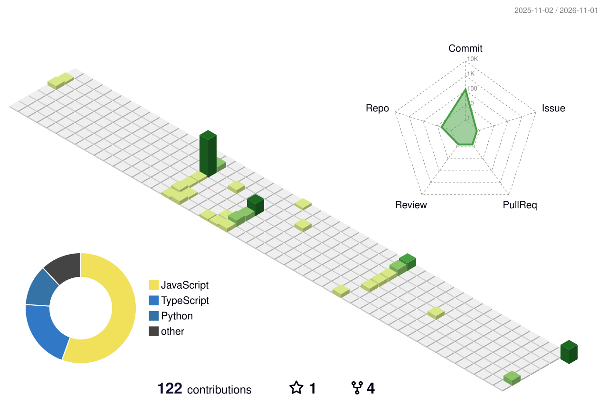

<div align="center">


</div>

<br>

<div align="center">
  
</div>

```bash
guest@LighTnos:~$ whoami
```
```text
udit-agrawal

Role      : Software Engineer Intern @ DrongoAI
Stack     : React, Node.js, Express, MongoDB, Tailwind CSS
Focus     : Product-speed delivery + clean scalable architecture
Exploring : Python and ML systems
```

<br>

<div align="center">
  
</div>

<br>

<div align="center">
  
  <br><br>
  
  <br><br>
  
  
</div>

<br>

<div align="center">
  
  <br><br>
  
</div>

<br>

<div align="center">
  
  <br><br>
  
</div>

<br>

<div align="center">
  <a href="https://www.linkedin.com/in/udit-agrawal-141292276/" target="_blank"></a>
  <a href="https://github.com/LighTnos" target="_blank"></a>
  <br><br>
  
</div>
