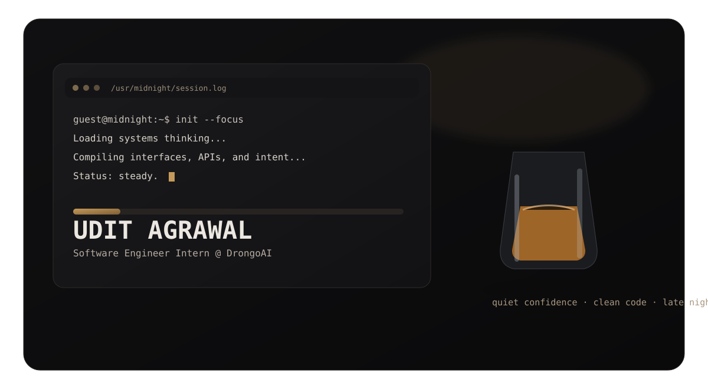
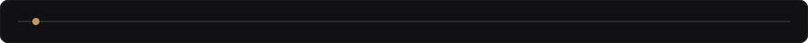
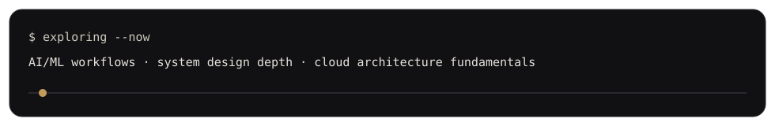
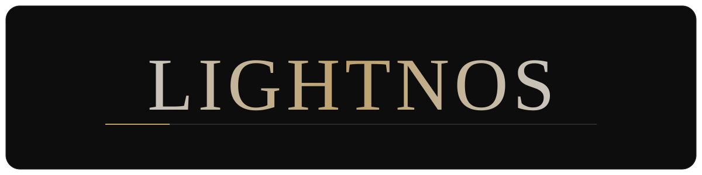

  

 

  

  Building quietly, shipping deliberately.

 

## About

I build product-focused software with a systems mindset — balancing clean architecture, reliable delivery, and thoughtful user experience.
My current work spans modern JavaScript/TypeScript apps, backend services, and applied ML exploration where software meets intelligence.

 

## What I Work With

 

## Selected Projects

<table>
  <tr>
    <td width="50%" valign="top">
      
      <h3>NewsX</h3>
      
Interactive 3D globe for country-precise world news with in-app full article reading and translation.

      
<b>Stack:</b> Next.js, TypeScript, Three.js, Tailwind CSS

      <a href="https://github.com/LighTnos/NewsX">Repository</a> ·
      <a href="https://news-x-rho.vercel.app">Live</a>
    </td>
    <td width="50%" valign="top">
      
      <h3>VitalTwin</h3>
      
AI health digital-twin platform with 3D dashboard, organ-level insights, and ML-backed health simulation.

      
<b>Stack:</b> Next.js, Python (FastAPI), ML, Three.js

      <a href="https://github.com/LighTnos/VitalTwin">Repository</a> ·
      <a href="https://inceptrix.vercel.app">Live</a>
    </td>
  </tr>
  <tr>
    <td width="50%" valign="top">
      
      <h3>Portfolio (Full-Stack)</h3>
      
Full-stack portfolio platform with admin dashboard, analytics, and AI-assisted GitHub project analysis.

      
<b>Stack:</b> React, Node.js, Express, MongoDB, Groq AI

      <a href="https://github.com/LighTnos/Portfolio">Repository</a> ·
      <a href="https://portfolio-lightnos-projects.vercel.app">Live</a>
    </td>
    <td width="50%" valign="top">
      
      <h3>The-Planets</h3>
      
Immersive 3D planet explorer with scroll-based navigation, cinematic transitions, and custom space scenes.

      
<b>Stack:</b> JavaScript, Three.js, Tailwind CSS, Vite

      <a href="https://github.com/LighTnos/The-Planets">Repository</a> ·
      <a href="https://the-planets-pied.vercel.app">Live</a>
    </td>
  </tr>
</table>

 

## Currently Exploring

  

 

## Connect

  
  

   

  

