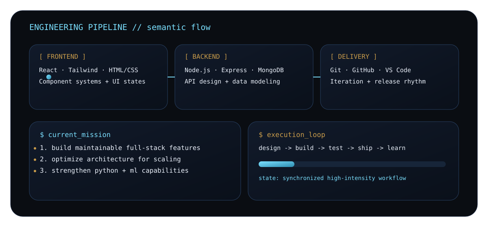
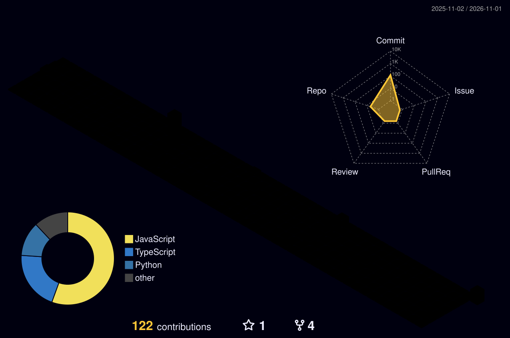

<div align="center">
  
</div>

<br>

<div align="center">

```bash
guest@LighTnos:~$ about --summary
```
```text
name     : Udit Agrawal
role     : Software Engineer Intern @ DrongoAI
focus    : scalable product engineering
learning : Python + Machine Learning systems
vibe     : cool coder, clean execution
```

</div>

<br>

<div align="center">
  
</div>

<br>

<div align="center">
  
  
</div>

<br>

<div align="center">
  
  <br><br>
  
</div>

<br>

<div align="center">
  <a href="https://www.linkedin.com/in/udit-agrawal-141292276/" target="_blank"></a>
  <a href="https://github.com/LighTnos" target="_blank"></a>
</div>
