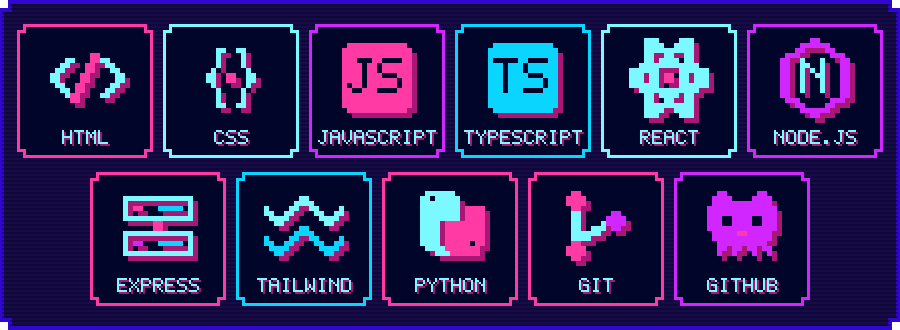

 
 

hey, i'm **udit** 👋 
web dev who learns by building things and breaking them a little. 
mostly writing TypeScript, JavaScript and Python. 
if it compiles, it ships. if it doesn't, we vibe-debug.

 

 

🔭 leveling up in TypeScript 
🐍 messing around with Python 
🌱 always building something new

 

> `it works on my machine ¯\_(ツ)_/¯`

 

<picture>
  <source media="(prefers-color-scheme: dark)" srcset="https://raw.githubusercontent.com/LighTnos/LighTnos/output/github-contribution-grid-snake-dark.svg" />
  
</picture>

